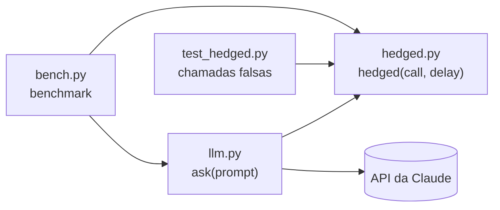
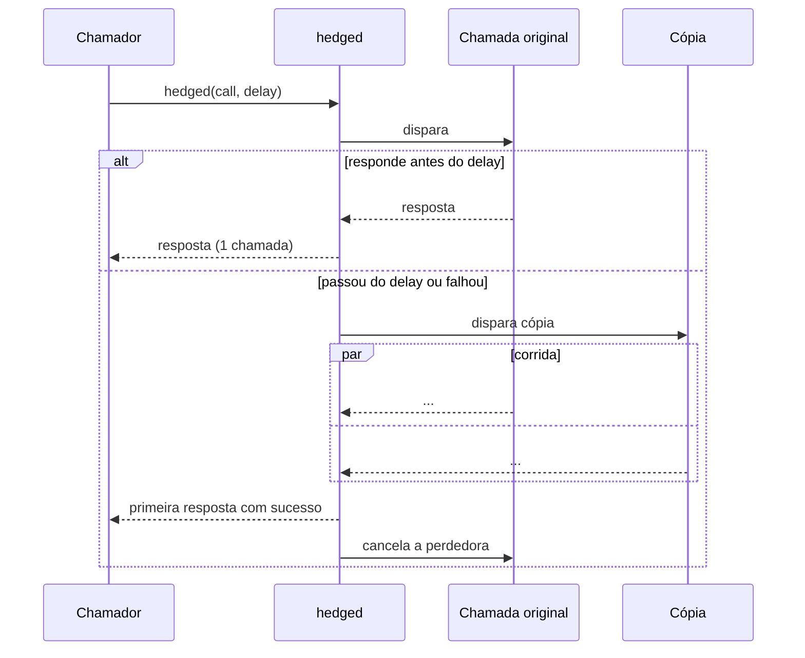

# hedged-request

## Arquitetura

| Módulo | Responsabilidade |
|---|---|
| `hedged.py` | A técnica. Recebe qualquer chamada assíncrona e um `delay`; não conhece LLM. Só stdlib (`asyncio`). |
| `llm.py` | Cliente da Claude (`AsyncAnthropic`). `ask(prompt)` faz uma chamada e devolve o texto. |
| `bench.py` | Mede N chamadas sem e com hedge, usa o p90 medido como `delay`, reporta p50/p90/p95/p99, custo extra e gera `latencia.png`. |
| `test_hedged.py` | Testa `hedged` com chamadas falsas (`asyncio.sleep`): sem API, sem custo. |

### Fluxo do `hedged`

Regras:

- A cópia só é disparada se a original passar do `delay` **ou** falhar.
- Vence a primeira chamada que terminar **com sucesso**; erro não vence corrida.
- Só lança erro se todas falharem.
- As perdedoras são canceladas no `finally`, em qualquer cenário.
